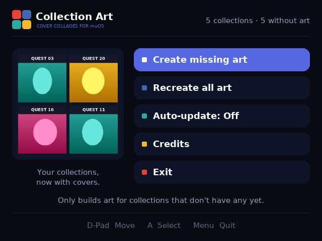
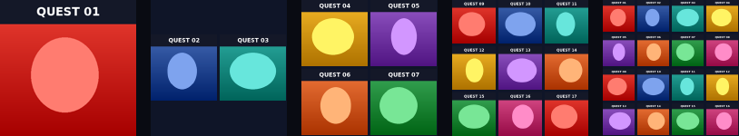
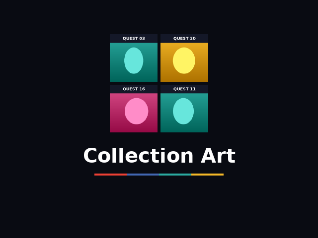
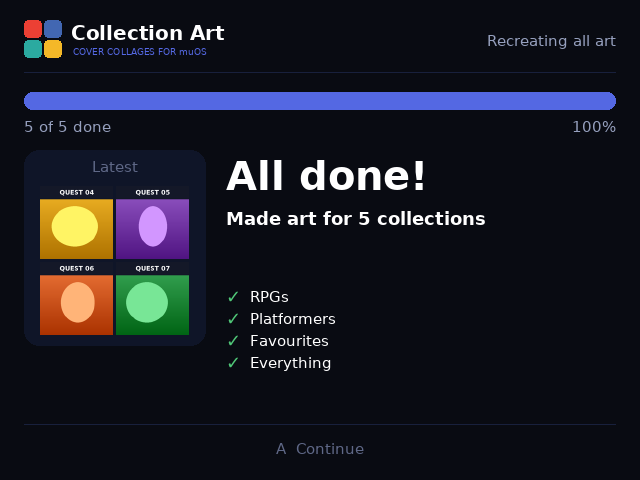
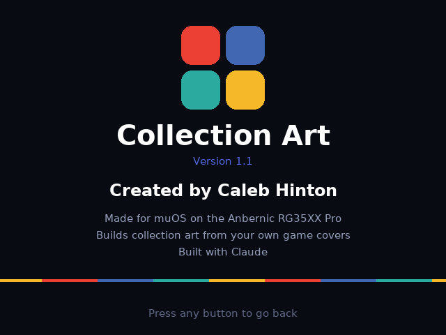

# Collection Art for muOS

**Give your muOS collections real cover art — built automatically from the box art of the games inside them.**

muOS lets you group games into collections, but every collection shows up as a blank tile because nothing ever creates artwork for it. Collection Art fixes that: it looks inside each collection, pulls the covers of the games you put there, and builds a collage that muOS displays in both grid mode and the box art preview.



## Features

- **Automatic collages** made from your own scraped box art — no downloads, no internet needed
- **Smart layouts** based on how many games a collection holds:

  | Games in collection | Collection art |
  |---|---|
  | 1 | That game's own cover |
  | 2 | The two covers side by side |
  | 3–8 | 2×2 grid |
  | 9–15 | 3×3 grid |
  | 16+ | 4×4 grid |

  

- **Create missing art** — only touches collections that don't have an image yet
- **Recreate all art** — rebuilds every collection image from scratch
- **Auto-update** — an optional background watcher that rebuilds a collection's art whenever you add or remove games
- **Full-screen interface** with an animated intro, live progress, a preview of each collage as it's made, and credits
- **Zero dependencies** — pure Python 3 standard library (PNG decoding/encoding is done in-app), so it runs on stock muOS
- **Fast start-up** — UI assets ship pre-decoded and intro covers are cached, so the app opens almost instantly

| Intro | Finished run | Credits |
|---|---|---|
|  |  |  |

## Requirements

- A handheld running **muOS** (MustardOS). Developed and tested on the **Anbernic RG35XX Pro** (640×480). Other 640×480 muOS devices should work as-is.
- Box art and/or grid art already in your catalogue (`MUOS/info/catalogue/<System>/box` or `/grid`), e.g. from Scrappy or any scraper.
- At least one collection.

## Installation

1. Download the latest `CollectionArt.zip` from [Releases](../../releases) (or clone this repo).
2. Copy the **`CollectionArt`** folder into **`MUOS/application/`** on the SD card where your applications live:
   ```
   MUOS/
   └── application/
       └── CollectionArt/
           ├── mux_launch.sh
           ├── app.py
           ├── artlib.py
           └── ...
   ```
3. On the device go to **Applications → Coll. Art**.

## Usage

| Button | Action |
|---|---|
| D-Pad | Move |
| A / any face button / Start | Select |
| Menu / Select | Back, stop a running job, quit |

1. Choose **Create missing art** (or **Recreate all art** the first time).
2. Watch the progress screen — each finished collage appears in the *Latest* panel.
3. Back out to muOS and open **Collections**. With a grid theme and *Content Grid Mode* enabled, your collections now show their collages.

Generated images are written to:

```
MUOS/info/catalogue/Collection/grid/<Collection Name>.png   (150×150)
MUOS/info/catalogue/Collection/box/<Collection Name>.png    (300×300)
```

### Auto-update

muOS has no event hook for "a collection changed", so Collection Art provides its own:

1. In the app, set **Auto-update: On**. This writes `MUOS/init/collectionart_watch.sh` to SD1 and starts the watcher immediately.
2. In muOS enable **Configuration → Advanced Settings → User Init Scripts**, so the watcher starts on every boot.

The watcher (`watch.sh`) checks your collections every 15 seconds using a cheap file-list fingerprint. When something changes it runs `app.py --auto` at the lowest CPU priority, which builds art for new collections and rebuilds any collection it previously made whose games changed. Collections you gave a custom image are never touched in auto mode. Turning Auto-update off removes the init script and stops the watcher.

## How it works

- **Finding games:** each collection is a folder of `.cfg` files under `MUOS/info/collection`. The game's name is taken from the file name (minus muOS's hash suffix) and from paths inside the file, then matched case-insensitively against every `box`/`grid` image across all catalogue locations (SD1, SD2 and the `/run/muos/storage` bind mount).
- **Drawing:** images are decoded with a small built-in PNG reader, scaled with box filtering, center-cropped into square cells (or fitted, for the two-game layout) and written back out as PNG — all with the Python standard library.
- **Display:** the UI renders into a 640×480 RGB buffer and presents it through SDL2 (via `ctypes`), falling back to writing `/dev/fb0` directly. Input is read straight from `/dev/input/event*`.
- **Bookkeeping:** `Collection/.collectionart.json` remembers which images the app created and a fingerprint of each collection's contents, so auto mode knows what's stale and never overwrites your own artwork.

### Project layout

```
CollectionArt/
├── mux_launch.sh      # muOS application launcher
├── mux_lang.ini       # display names
├── app.py             # UI, input, display backends, --auto mode
├── artlib.py          # PNG codec, scaling, collage layouts, library scanning
├── watch.sh           # auto-update watcher
├── assets/            # font atlas, logos (.bin = pre-decoded for fast start, .png = source)
└── glyph/             # launcher icon (recoloured by your theme)
tools/
└── make_assets.py     # regenerates the font atlas, logos and .bin files (needs Pillow, run on a PC)
```

## Troubleshooting

- **Nothing happens when I open the app** — check `MUOS/application/CollectionArt/last_run.log`. If it says `python3 not found`, your muOS build lacks Python 3.
- **A collection stays blank / "no covers"** — none of its games have box or grid art in your catalogue. Scrape those games first, then run *Create missing art* again.
- **Several collections share one image** — muOS matches collection art by name, so collections with the same name (e.g. multiple named "Collection") share a single image. Rename them.
- **Grid tiles look white or tinted** — your theme recolours grid images. In the theme's `scheme/muxplore.ini` add:
  ```ini
  [grid]
  CELL_DEFAULT_IMAGE_RECOLOUR_ALPHA = 0
  CELL_FOCUS_IMAGE_RECOLOUR_ALPHA = 0
  ```
- **Buttons don't respond as expected** — button codes differ between devices; any face button selects and Menu/Select goes back. Open an issue with your device model.

## Contributing

Issues and pull requests are welcome — especially testing reports from other muOS devices and resolutions. To change the font or logos, edit `tools/make_assets.py` and run it on a PC with Pillow installed; it rewrites both the `.png` and the fast-loading `.bin` files.

## Credits

Created by **Caleb Hinton**. Built with Claude.

Thanks to the [MustardOS](https://muos.dev) team for muOS and its documentation.

## License

[MIT](LICENSE)
